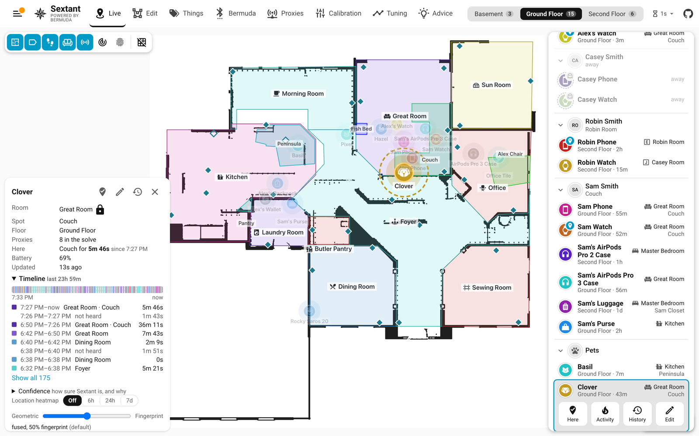

# Sextant

**Know which room every person, pet and phone is in, live on your own floor plan, in Home Assistant.**

Sextant listens to the Bluetooth devices around your house (phones,
watches, pet collar tags, key finders) through the small Bluetooth
receivers you may already have, and places each one on a map of your
home. Your automations then know who is in which room, and even on which
spot: the sofa, the bed, the dog basket.

<!-- SCREENSHOT TO REPLACE: hero image. See "Shot list" in the PR description.
     A cropped Live page: one floor, a few people and pets, one pet's card open,
     with fewer overlapping labels than the current image. -->

## What you can do with it

- 🐶 **"Where's the dog?"** Open the map and see her on the bed upstairs.
  The same works for the cat, your phone, your watch or the car keys.
- 💡 **Lights and music that follow you.** Walk into the kitchen and its
  lights come on; leave the study and it goes dark. Music can move from
  room to room with you.
  ([Recipe](docs/recipes.md#lights-follow-a-person-from-room-to-room))
- 🛏️ **Rooms that know who is in them.** Every room gets a sensor that
  says who is inside, people and pets by name. Skip heating empty
  bedrooms, or pause the TV when the last person walks out.
  ([Recipe](docs/recipes.md#nobody-left-in-a-room))
- 🐱 **Keep an eye on the pets.** Count how often each cat visits the
  litter box, and hear about it when the count stops going up.
  ([Recipe](docs/recipes.md#a-cat-at-the-litter-boxes))
- 📱 **"You left your phone at home."** Get a nudge when you've gone out
  and your phone is still in the house, or when your wallet goes quiet,
  with the room it was last heard in.
  ([Recipes](docs/recipes.md#a-phone-left-behind))
- 🗣️ **Just ask.** "Where is Alex?", "Who is in the kitchen?", "Who is
  home?" with Home Assistant's voice assistant.
  ([Voice setup](docs/voice.md#voice-assist))

<!-- SCREENSHOT TO ADD: the Occupancy page, every room at a glance with
     who is in it. See "Shot list" in the PR description. -->

## How it works

1. **Bluetooth receivers hear your things.** ESP32 boards running ESPHome
   or Shelly Plus switches and plugs act as Bluetooth proxies, a few per
   floor. Phones, watches and tags are heard by several of them at once.
2. **[Bermuda](https://github.com/agittins/bermuda) turns that into
   distances.** It is a Home Assistant integration that works out how far
   each thing is from each receiver.
3. **Sextant puts it on your floor plan.** It turns those distances into a
   position on the map, then decides the floor, the room and the spot, and
   keeps the answer steady so a watch on the line between two rooms
   doesn't flip back and forth.

It doesn't have to rely on Bluetooth alone. Add the motion sensors,
mmWave presence sensors, door contacts and TVs you already have to a room
and Sextant counts them too, so a guest without a phone still lights up
the room.

*Bluetooth, mmWave radar, motion sensors, a door and a TV working together:
Sam is in the Study, Robin in the Bedroom and Pepper the cat in the
Lounge. [How occupancy works](docs/occupancy.md) explains it.*

## What you need

- **Home Assistant** with **[Bermuda](https://github.com/agittins/bermuda)**
  installed.
- **At least three Bluetooth proxies on each floor.** More gives better
  answers; one every three to four metres gets you the right room.
- **A floor plan image** for each floor, ideally to scale. A builder's
  plan works.
- **Something to track:** a phone with the Home Assistant app, a watch,
  an iBeacon pet tag, a Tile or a Find My accessory.

That's enough to start. [What you need](docs/install.md#what-you-need)
has the full list, including the one setting each ESPHome proxy needs for
calibration, and why some features want
[the Bermuda fork](https://github.com/davidcoulson/bermuda).

## Get started

1. Install **Sextant** from the Marketplace with the button above, or
   **Settings → Marketplace → Add from link** and `davidcoulson/sextant`.
2. Go to **Settings → Devices & Services → Add Integration → Sextant**.
3. Open **Sextant** in the sidebar. Upload your floor plan, draw your
   rooms and mark where the proxies are.
4. Pick what to track. It shows up on the map a few seconds later.

There's no YAML for Sextant itself: everything is set up on its own page
in Home Assistant. Plan on an afternoon for a whole house; most of it is
drawing rooms. [Getting started](docs/getting-started.md) walks through
every step and ends with a first automation.

On Home Assistant 2026.9 or 2026.10, install it through HACS →
**Custom repositories** instead, as an Integration
([details](docs/install.md#installation)).

## A tour of the Sextant page

Sextant adds its own page to the Home Assistant sidebar, in your theme
and units:

- **[Live](docs/live.md)**: everything on the plan, with each thing's room,
  spot, floor and history.
- **Occupancy**: every room at a glance, with who is in it.
- **[Edit](docs/edit.md)**: draw rooms and spots, place proxies and sensors.
- **[Things](docs/things.md)**: choose what to track, give things names,
  colours and owners.
- **Setup**: [Bermuda](docs/bermuda.md), [Proxies](docs/proxies.md),
  [Calibration](docs/calibration.md) and [Advice](docs/advice.md) on where
  one more proxy would help most. Expert mode adds
  [Tuning](docs/tuning.md).

<!-- SCREENSHOTS TO ADD: a small strip of Edit (drawing a room), Things
     (giving a tag an owner) and Advice. See "Shot list" in the PR description. -->

A few more things it does:

- **People, not just phones.** Give each phone, watch or tag an owner and
  Sextant places the person by whichever of their things is with them.
- **Steady answers.** Someone asleep on the sofa stays "on the sofa".
- **Teach it.** If something shows up in the wrong place, click where it
  really is and Sextant works out better settings for your house.
- **Robot vacuums and Wi-Fi.** Roborock vacuums show up on the plan too
  (with the [Roborock override](https://github.com/davidcoulson/ha-roborock-override)),
  and with UniFi a phone on the home Wi-Fi keeps its owner home.

## How it compares

Other Home Assistant projects do part of this. Bermuda and ESPresense
track Bluetooth devices; Magic Areas and Area Occupancy Detection turn
sensors into room occupancy. Sextant does both, on a floor plan, and
leaves what to do about it to your automations. It works alongside them:
it needs Bermuda to hear the devices, and its room sensors can feed Magic
Areas or Area Occupancy Detection.

Sextant began as a fork of [BPS](https://github.com/Hogster/BPS) and can
[take over a BPS setup](docs/install.md#upgrading-from-bps-or-bps-improved).
[Where Sextant fits](docs/compared.md#next-to-other-room-presence-projects)
has the full side-by-side table.

## Docs

| Start | Set up | Improve | Automate |
|---|---|---|---|
| [Getting started](docs/getting-started.md) · [Installing](docs/install.md) · [Hardware](docs/hardware.md) | [Edit](docs/edit.md) · [Things](docs/things.md) · [Bermuda](docs/bermuda.md) · [Proxies](docs/proxies.md) | [Live](docs/live.md) · [Calibration](docs/calibration.md) · [Tuning](docs/tuning.md) · [Advice](docs/advice.md) · [How positioning works](docs/positioning.md) | [Recipes](docs/recipes.md) · [How occupancy works](docs/occupancy.md) · [Sensors, card and services](docs/automation.md) · [Voice](docs/voice.md) |

Also [Where Sextant fits](docs/compared.md) and
[Data and development](docs/development.md).

## Built with AI, tested in a real house

Sextant was written with [Claude](https://claude.ai) as a coding partner.
Claude wrote most of the code, tests and docs; the author sets the
direction and decides what ships. Every change runs in the author's home
first: more than 100 Bluetooth proxies, 21 rooms on three floors, mmWave
sensors, three robot vacuums, and a mix of people, phones, watches and
seven animals wearing collar tags. Bugs are still bugs, whoever typed
them, so issues and pull requests are welcome.

## Credits

Sextant began as a fork of [Hogster/BPS](https://github.com/Hogster/BPS)
via [maxi1134/BPS-improved](https://github.com/maxi1134/BPS-improved).
Thanks to [@Hogster](https://github.com/Hogster) and
[@maxi1134](https://github.com/maxi1134) for the original integration, to
[@agittins](https://github.com/agittins) for
[Bermuda](https://github.com/agittins/bermuda), and to
[Megarushing](https://github.com/Megarushing/bermuda) for the Find My
support in the Bermuda fork. MIT licensed, see [LICENSE](LICENSE).
