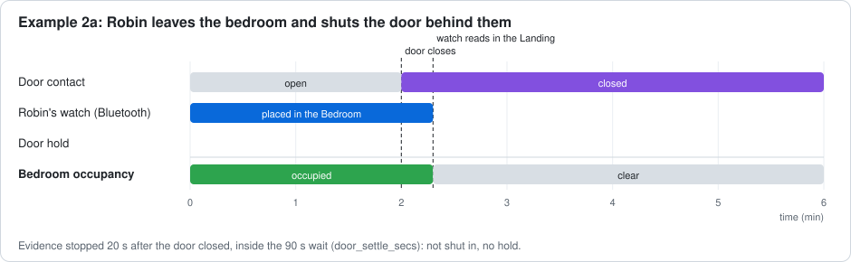

[Sextant](../README.md) › How occupancy works

# How occupancy works

Sextant gives every room on your plan an occupancy sensor. It answers the
question a room automation asks: is anyone in here, and who? This page
explains how a room turns on, what keeps it on, and what turns it off. It
uses an invented house and invented people throughout.

The house below is Larkspur Cottage. Sam works in the Study, Robin sleeps
in the Bedroom, and Pepper the cat goes where she likes. Each room has the
sensors drawn in it.

## The sensors Sextant makes

| Entity | On while |
|---|---|
| `binary_sensor.<room>_sextant_occupancy` | anyone is in the room: a person, a pet, or something a sensor saw |
| `binary_sensor.<room>_sextant_people_occupancy` | the same, but a pet's tag alone leaves it off |
| `binary_sensor.<floor>_sextant_floor_occupancy` | any room on that floor is on |
| `binary_sensor.<floor>_sextant_floor_people_occupancy` | any room's people sensor on that floor is on |
| `binary_sensor.sextant_house_occupancy` | any room in the house is on |
| `binary_sensor.sextant_house_people_occupancy` | any room's people sensor is on |
| `switch.<room>_sextant_force_occupied` | you turn it on: the room stays on whatever Sextant hears |
| `sensor.sextant_people_home` | (a number) how many people are home |
| `sensor.sextant_household_floor` | (a floor name) the one floor everyone at home is on |

For Larkspur Cottage that is `binary_sensor.study_sextant_occupancy`,
`binary_sensor.lounge_sextant_people_occupancy` and so on. The full list of
attributes is in [Sensors, card, services and API](automation.md#rooms).

## How a room decides

Every positioning cycle, and, with a radar on the plan, every time the
radars are read (twice a second by default), each room asks one question: does anything say someone is here
right now? If any source says yes, the room is on. If none does, a few
holds can still keep it on for a while. Then the room picks a state.

The room's `state` attribute has three values:

- **occupied**: someone is here.
- **extended**: someone has been here for `room_extended_secs` (10 minutes)
  without a break. Use it to treat a long stay differently from someone
  walking through, for example to leave the lights alone or to start the
  heating.
- **clear**: nobody is here, and no hold is running.

The `sources` attribute says why the room is on: `bluetooth`, `radar`,
`media_player`, `sensor`, `forced`, `door`, `restored` or `hold`.
`since` is when the sensor last turned on or off.

## Every kind of sensor a room can use

| Sensor | What it does to the room | How long it holds | What it cannot tell you |
|---|---|---|---|
| **A tracked person's thing** (phone, watch) | On while the thing that speaks for its owner is placed in the room. Lists the person under `people`. | While the thing is `here` (heard in the last 2 minutes, `stale_after_secs`) or `quiet` (heard in the last 15 minutes, `away_after_secs`). | Whether the person is really with it. A watch left on the bedside table while its owner's phone is in the Kitchen does not count: only the one thing speaking for each person counts. |
| **A pet's tag** (class cat, dog or paw) | On the room sensor, listed under `pets`. Not on the people sensor. | The same as a person's thing. | Anything about people. |
| **Other tracked things** (keys, a wallet, a suitcase) | Listed under `things`, but they do not turn the room on. | n/a | n/a |
| **A thing nobody owns** (a guest's phone) | Counts by its class: a phone, watch, person, child or pet class turns the room on. A thing's own **Gives the owner's location** setting on the [Things page](things.md) wins over its class. | The same as a person's thing. | Who it belongs to. |
| **mmWave radar that tracks** (LD2450 type, such as an Everything Presence or an Apollo R PRO-1), placed on the plan | On while a track is in the room, whether or not the person carries anything. A new target must be seen for 2 seconds (`mmwave_verify_s`) before it counts, so a reflection does not. Counts as a person on the people sensor. | `mmwave_hold_s` (10 s) after the radar loses everyone, or the room's own **Stays occupied for**. | A person from a pet. Someone lying very still can drop out of view. It sees through drywall, so targets outside the radar's own room are dropped. |
| **Presence sensor** (an LD2412, or any occupancy, presence or motion binary sensor), set as the room's **Presence sensor** | On while it reads `on`. Counts as one person (`radar: 1`) whoever is there. | The same hold as the tracking radar. | Where in the room, or how many. It is read on the radar's clock, so it only counts while at least one mmWave radar is placed on the plan. |
| **Motion sensor**, listed under **Other sensors** | On while it reads `on`. Counts as a person on the people sensor. | Only as long as the sensor itself stays `on`, plus the room's clear-after hold. | Someone sitting still. A pet. |
| **Media player**, listed under **Other sensors** | On while it reads `playing`. | While it plays. | Whether anyone is watching. |
| **A number**, listed under **Other sensors** with a test, such as `sensor.tv_power>20`, `sensor.desk_lux<5` or a camera's person count (`sensor.hall_person_count>0`) | On while the test is true (`>`, `>=`, `<`, `<=`). An unavailable or non-numeric reading counts as nothing. | While the test is true. | Anything but the number. |
| **A person or device tracker**, listed under **Other sensors** | On while it reads `home`. | While it reads `home`. | Which room they are in. Listing one makes the room on whenever that person is home, so use it with care. |
| **Any other entity** listed under **Other sensors** | On while it reads `on`, `home`, `playing`, `occupied` or `detected`. | While it reads so. | Whatever that sensor cannot. |
| **Door contact**, set as the room's **Door contact** (a contact binary sensor, a cover or a lock) | Never turns the room on by itself. Someone who keeps reading in the room for `door_settle_secs` (90 s) after the door closes has shut themselves in: the room then stays on until the door opens. | Until the door opens, everyone it was holding for is placed in another room, or `door_hold_max_secs` (8 hours) passes. A door closed for `door_entry_grace_secs` (3 minutes) also keeps things outside from being placed in the room until it opens. | Whether anyone is inside when nobody was seen after it closed. |
| **Wi-Fi** (an access point that sees a person's phone) | Never puts anyone in a room. It keeps a person counted in `sensor.sextant_people_home` when Bluetooth has lost them. | A Wi-Fi "home" must stand for `wifi_confirm_secs` (5 minutes) before it starts a visit. | Which room. |
| **Force occupied switch** | On while the switch is on. Counts as a person on the people sensor. | Until you turn it off. It survives a restart. | Nothing: it is your word. |
| **Robot vacuum** | Never counts. | n/a | n/a |

A few rules sit on top of the table:

- A thing placed **outside** (in the garden, or gone out through a room
  with an outside door) counts for no room, even the nearest.
- A thing that has gone **away** (not heard for 15 minutes) counts for no
  room.
- A Sextant occupancy sensor and the room's own door are ignored if you list
  them under **Other sensors**: one would hold itself on, and an open door
  is not a person.

### Broken sensors

A stuck sensor holds its room on forever, and a dead one never turns it on.
Sextant raises a Repair (Settings → System → Repairs) for a room's sensor
(an input or a door) when:

- it has been missing, unavailable or unknown for `sensor_gone_secs`
  (6 hours). A media player that reads unavailable (a TV
  switched off) is not called gone;
- it is a binary sensor that has read `on` for `sensor_stuck_secs`
  (24 hours). Numbers, media players and trackers are never called stuck,
  and neither is a door left shut.

The Repair clears itself when the sensor reads normally again.

## Room occupancy and people occupancy

Each room has two sensors. Use the right one:

- **Room occupancy** (`_sextant_occupancy`) is on for anyone: a person, a
  pet, a radar target or a sensor. Use it for things a pet needs too, such
  as heating.
- **People occupancy** (`_sextant_people_occupancy`) is off when the only
  thing in the room is a pet's tag. Use it for lights, so they go off when
  the people leave and the cat stays.

Radars, presence sensors, other sensors and the force switch cannot tell a
pet from a person, so they turn the people sensor on as well. A cat that
walks past a motion sensor turns the people sensor on until the motion
sensor goes off. Example 3 below shows this.

## Floors and the house

The floor and house sensors are roll-ups of the rooms. A floor is on while
any of its rooms is on, and lists the `rooms` that are on, the `people` and
`pets` on it, and a `count`. The house sensor does the same for every
floor. The people-only twins roll up the rooms' people sensors.

Two more sensors count people rather than rooms:

- `sensor.sextant_people_home` is how many people are home. A person counts
  while Bluetooth hears them (`here` or `quiet`), or while Bluetooth has
  lost them but their phone is still on the house's Wi-Fi. Pets are listed
  apart, under `pets_home`, and are not counted.
- `sensor.sextant_household_floor` is the one floor everyone at home is on.
  It reads `away` with nobody home, `mixed` when people are on different
  floors, and `unknown` while anyone at home is on no floor (lost, outside,
  or known only from Wi-Fi).

## Settings that change this

All of these are on the Tuning page, or set with `sextant.set_tuning`. See
[Tuning](tuning.md).

| Setting | Default | What it does |
|---|---|---|
| `room_hold_secs` | 0 s (up to 3600) | How long a room stays on after the last reading that said someone was there. 0 follows the readings. |
| `room_extended_secs` | 600 s (30 to 86400) | How long a stay lasts before `state` reads `extended`. |
| `door_settle_secs` | 90 s (0 to 600) | How long someone must keep reading in a room after its door closes to count as shut in. |
| `door_hold_max_secs` | 28800 s, 8 hours (60 to 172800) | A door hold lets go after this long even if the door never opens. |
| `door_entry_grace_secs` | 180 s (0 to 3600) | Once a room's door has been closed this long, no thing outside the room is placed in it: a cat read through the wall is not in a room it cannot open. Things already inside stay. A thing that slipped in just before the door closed and was placed late still makes it within this time. A door that comes back closed after a restart, or after reading unavailable, closes its room at once. |
| `mmwave_rooms` | on | Whether radar tracks and presence sensors count towards rooms at all. |
| `mmwave_hold_s` | 10 s (0 to 3600) | How long a room stays on after the radar loses everyone in it. |
| `mmwave_verify_s` | 2 s (0 to 30) | How long a new radar target must be seen before it counts. |
| `mmwave_tick_s` | 0.5 s (0.2 to 15) | How often the radars are read. |
| `stale_after_secs` | 120 s (15 to 3600) | A thing not heard for this long is `quiet`. It still counts for its room. |
| `away_after_secs` | 900 s (60 to 86400) | A thing not heard for this long is `away`, and no longer counts for any room. |
| `exit_quiet_secs` | 120 s (0 to 3600) | Someone who goes quiet in a room with an outside door reads Outside after this long (not a cat). |
| `wifi_confirm_secs` | 300 s (0 to 3600) | How long Wi-Fi must say "home" before it starts a visit for someone Bluetooth has lost. |
| `sensor_gone_secs` | 21600 s, 6 hours (600 to 2592000) | When an unavailable room sensor gets a Repair. |
| `sensor_stuck_secs` | 86400 s, 24 hours (3600 to 2592000) | When a binary sensor stuck `on` gets a Repair. |

Each room can also have its own settings on the [Edit page](edit.md):
select the room, and its **Occupancy sensor** block takes:

- **Clears after** and **Extended after**: this room's own
  `room_hold_secs` and `room_extended_secs`.
- **Other sensors that mean someone is here**: the inputs from the table
  above, comma-separated.
- **Door contact**.
- **Has an outside door**.

With a radar on the floor, a room also takes **Stays occupied for** (its own
`mmwave_hold_s`) and **Presence sensor**.

## Worked examples

### 1. Someone walks in and sits still

Sam walks into the Study at minute 0 and reads until minute 18. The Study
has a motion sensor, a tracking radar and an LD2412 presence sensor, and
Sam's phone is in their pocket.

- At 0 the motion sensor and the radar see Sam, and the room turns on.
- Within a cycle Sam's phone is placed in the Study. `people` reads `Sam`.
- At 3 Sam sits still. The motion sensor goes off and the radar loses
  them. The presence sensor and the phone still say someone is here, so
  nothing changes.
- At 10 the room has been on for `room_extended_secs`, and `state` reads
  `extended`.
- At 18 Sam leaves. The motion sensor blips as they pass it, the presence
  sensor goes off (its 10-second radar hold runs out a moment later) and the
  phone is placed in the Hall. With no hold set, the room clears as soon as
  none of them says someone is there.

Without the phone and the presence sensor, the room would have cleared 10
seconds after the radar lost Sam, and come back on only for the motion
sensor's blips. A longer **Stays occupied for** on a
reading room, or a presence sensor, covers that.

### 2. Someone leaves and shuts the door

The Bedroom has a door contact. What the door does depends on whether
anyone is still seen inside after it closes.

**Leaving.** Robin walks out at minute 2 and pulls the door shut behind
them. Their watch is placed on the Landing 20 seconds later.

The evidence stopped inside the 90-second wait (`door_settle_secs`), so
Sextant knows the door was shut from outside. There is no hold, and the
room clears. It will not take hold again until the door is opened.

This only works if every sensor in the room stops within the wait. A motion
sensor that stays `on` for two minutes after the last movement still reads
as someone inside when the 90 seconds are up, and the room is held. Give
such a room a longer `door_settle_secs`, or a sensor that clears sooner.

**Going to bed.** Robin goes into the Bedroom, shuts the door at minute 1,
and gets into bed. Their phone is charging in the Kitchen, so only the
motion sensor sees them.

- At 2.5 Robin has kept moving inside for 90 seconds after the door
  closed. Sextant takes them to be shut in: `door_hold` turns true and
  `sources` includes `door`.
- At 4 Robin lies still and the motion sensor goes off. The room stays on.
- At 27 the door opens. The hold ends, and the room clears once the motion
  sensor goes off.

The hold also ends if everyone it was holding for is placed in another room,
or after `door_hold_max_secs` (8 hours). An unavailable door sensor keeps
the hold as it was.

### 3. A pet alone in a room

Pepper the cat is asleep in the Lounge. Nobody else is in.

- The Lounge occupancy sensor is on the whole time, with `pets: [Pepper]`
  and `people: []`.
- The Lounge people occupancy sensor is off, so lights that follow it stay
  off.
- At 6 Pepper jumps onto the sofa and sets off the motion sensor. A motion
  sensor cannot tell a cat from a person, so the people sensor turns on
  until the motion sensor goes off.

If your pets set off a room's motion sensor often, leave that sensor out of
the room's **Other sensors**, or give your automation a short delay.

### 4. A Home Assistant restart

Home Assistant restarts at minute 2. Sam is in the Lounge. The Kitchen was
on only because of its clear-after hold, and nobody is really there.

Right after a restart Sextant has not placed anything yet. Without help,
every room would go off and back on. Instead:

- A room that was on before the restart comes back on, with `sources:
  [restored]`.
- It stays on until a real reading says someone is there (the Lounge, at
  minute 4), or until the grace runs out (the Kitchen, at minute 13). The
  grace is `RESTORE_GRACE_S`, 600 seconds, counted once from when Sextant
  starts. Reloading Sextant does not grant a new one.
- A door hold carries over the restart, and keeps its first start time, so
  the 8-hour limit is not reset.
- A clear-after hold that was running is forgotten. The room keeps its
  `since` while the restored state shows, and after it if the room is
  still on when that ends (the Lounge), so a long stay is still `extended`. A room
  that turns out to be empty (the Kitchen) gets a new `since` when it clears.
- How soon things are placed again depends on how long Home Assistant was
  down. Within `restore_state_secs` (5 minutes) Sextant picks up its room
  choices where it left them, and a thing heard in the 10 minutes before
  Sextant came back counts as just heard for the first 5 minutes, so most rooms
  are confirmed within a cycle or two. After a longer gap every thing starts
  cold and has to earn its room again, which can take a few minutes; the
  600-second grace covers that.
- The force switch keeps its state.

## See also

- [Sensors, card, services and API](automation.md#rooms): every attribute
  of the room sensors.
- [Occupancy and voice](voice.md): the per-room settings and asking Assist
  who is where.
- [Edit](edit.md#mmwave-sensors): placing mmWave radars and presence
  sensors.
- [Live](live.md#occupancy-tab): the Occupancy tab, which shows every room
  and why it is on.
- [Tuning](tuning.md): changing the defaults.
