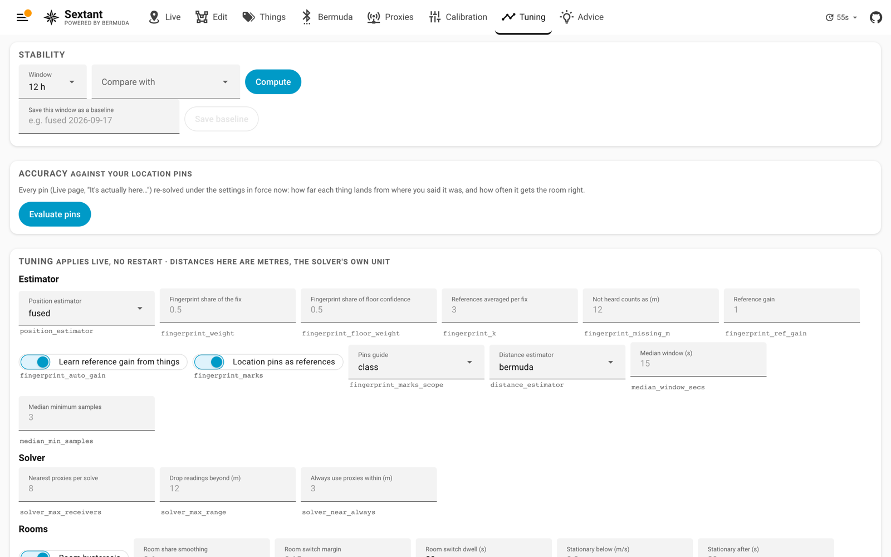

[Sextant](../README.md) › Tuning

# Tuning

The Tuning page is part of **Expert mode**: tick **Expert mode** at the right of the Setup bar to show it. The setting is kept per browser. Expert mode also shows the diagnostics under Proxies, the signal-link, range-circle and fingerprint layers and the Confidence and In the solve read-outs on Live, a floor's election bias, a proxy's Correction ×, a spot's Entry share, and a thing's routine pull, ref trim and positioning. With it off those stay at whatever they were set to and keep working; only the controls are hidden.

The knobs are folded by group, each heading saying how many you have changed; the filter opens whatever it matches. Accuracy, **Try a room setting** and position history are under **Experiments and history** at the bottom.

The **stability KPI** reads the recorder for any window and reports, per
thing, room changes per hour, the share that were A → B → A flips, the
median dwell, and *far moves* per day: changes to a room on the same floor
whose outline is more than 2.5 m from the previous room's. A walked move
between such rooms passes through a room in between, so a far move the plan
never saw in between is a position that jumped. In the house this was
built on, each pet makes about ten a day (3 to 15), and they last about as
long as ordinary room changes: over three days, 43 % of far moves and 35 %
of all other same-floor moves were followed by another change within two
minutes. So the level is not alarming in itself; a rise after a change is.
Since 2026.10.06 the room election holds a far move to `far_move_margin`
and `far_move_secs` (0.3 and 45 s against 0.15 and 20 s for a move next
door), so a jump has to persist before it is published; this KPI is how to
see what that bought, and the two knobs are below it. Save a window as a named
baseline and compare later windows against it; the deltas turn green where
the window is better. Every
[tuning key](tuning.md#tuning-reference) is below it with a plain label, its meaning
and default written under the field and the key underneath, grouped by estimator, solver, rooms,
spots, near-field anchor and floors, and applies on the next cycle without
a restart. A key set away from its default is marked *changed* with a
*reset* link that puts it back (press **Apply** to store that); a filter
box at the top narrows the list by key, label or meaning. Metre keys show
the default in feet as well when Home Assistant is set to US units, but
the value itself is always metres. Apply stores only the values that
differ from their defaults. Position history retention (off, one hour to seven
days) and **Clear history** live here too.

**Try a room setting** answers "what would this have done" before you apply
it. Pick one of the room election's settings, a value and a window, and
Sextant replays the election log twice, once with the settings as they are
and once with yours, and shows the room switches and bounces (a switch
undone within two minutes) for each, with the things that change most. It
changes nothing. It needs `election_log_hours` above 0 and some hours
recorded. The replay is an estimate (the log does not hold the filter's
uncertainty or a floor challenge in progress), so the card says how much of
what was actually published the replay reproduces at today's settings;
trust the difference between the two rows more than the totals.

## Tuning reference

Set from the Tuning page or `sextant.set_tuning`. Stored with the layout;
distances in metres.

| Key | Default | Effect |
|---|---|---|
| `position_estimator` | `geometric` | `geometric`, `fingerprint` or `fused` |
| `fingerprint_weight` | 0.5 | fingerprint share of a fused fix |
| `fingerprint_floor_weight` | 0.5 | fingerprint share of a floor's confidence |
| `fingerprint_k` | 3 | references averaged per fix |
| `fingerprint_missing_m` | 12 | how far "not heard" counts as |
| `fingerprint_ref_gain` | 1.0 | probe beacons hotter (<1) or cooler (>1) than things |
| `fingerprint_auto_gain` | true | learn the rest of that gain from the things |
| `range_auto_scale` | false | multiply each thing's ranges by the scale learned from its own fits |
| `fingerprint_marks` | true | location pins double as fingerprint references |
| `distance_estimator` | `bermuda` | `bermuda` or `median` |
| `median_window_secs` | 15 | samples newer than this feed the median |
| `median_min_samples` | 3 | fewer falls back to Bermuda's distance |
| `stale_interval_factor` | 5 | a reading is stale after this many times the gap its proxy usually hears the thing at (10 s floor, `reading_max_age` cap; 0 = the cap alone) |
| `solver_max_receivers` | 8 | nearest proxies per solve (0 = all) |
| `solver_max_range` | 12 | drop readings beyond this once three remain (0 = never) |
| `solver_near_always` | 3 | proxies within this always count |
| `zone_hysteresis` | true | off publishes the instantaneous room |
| `zone_prob_smoothing` | 0.6 | weight kept on the previous room shares per 15 s (a faster refresh compounds it, so the smoothing is the same in seconds) |
| `zone_switch_margin` | 0.15 | lead a challenger room needs |
| `zone_switch_secs` | 20 | held that long before switching |
| `far_move_margin` | 0.3 | the lead a room that is not next door needs (the larger of this and `zone_switch_margin`) |
| `habit_margin_gain` | 0.1 | how far a thing's usual room at this hour (weekday or weekend, learned over weeks) eases the lead a challenger room needs: at most this much, and only for a close call. 0 turns it off |
| `sensor_gone_secs` | 21600 | raise a repair for a room's input or door sensor that has been unavailable this long |
| `sensor_stuck_secs` | 86400 | raise a repair for a room's binary-sensor input that has read on this long, since it holds the room occupied |
| `far_move_secs` | 45 | held that long before a far move; 0 = no longer than any move |
| `stationary_speed` | 0.3 | m/s; slower is "still" |
| `stationary_secs` | 20 | still this long locks the room |
| `outside_margin_m` | 1.0 | metres beyond every room before a fix reads **Outside** (never for a cat); 0 turns it off |
| `outside_secs` | 45 | seconds it must hold, either way |
| `outside_faint_prox` | 6 | a dog heard by no more than this many proxies, with the nearest `outside_faint_m` or more away, for `outside_secs`, reads **Outside** even when its fix lands in a room (there is no proxy in the garden to pull it out); 0 turns it off |
| `outside_faint_m` | 3.0 | the nearest proxy this far or farther, with few hearing the dog, means the garden |
| `outside_near_m` | 1.5 | a proxy within this means the dog is back in the house |
| `zone_unlock_margin` | 1.0 | metres outside the locked room |
| `zone_unlock_secs` | 30 | for this long to unlock |
| `zone_lock_warmup_secs` | 120 | no stationary lock until a thing has been tracked this long since a start or floor change |
| `subzone_switch_secs` | 20 | dwell before a spot change |
| `subzone_enter_prob` | 0.5 | smoothed share needed to enter a spot |
| `subzone_unlock_margin` | 1.0 | metres outside a spot before leaving it |
| `spot_proxy_near_m` | 1.2 | a spot's own proxy counts fully within this |
| `spot_proxy_far_m` | 2.0 | ...and not at all from this far |
| `spot_proxy_ratio` | 2.0 | every other proxy this many times farther for full weight (none within 1.25×) |
| `floor_switch_secs` | 60 | a challenger floor must lead this long |
| `floor_switch_margin` | 0.05 | the lead a challenger floor needs before that dwell starts (a smaller lead that never lapses for 4 × `floor_switch_secs`, at least 2 minutes, still wins); raise to 0.10 when a still thing drifts between two near-tied floors |
| `floor_tenure_bonus` | 0.05 | extra margin at full tenure |
| `floor_tenure_full_secs` | 600 | tenure counted up to this |
| `floor_proximity_weight` | 0.5 | how much proximity scales a floor's score (0 = fit only) |
| `wifi_floor_weight` | 0.25 | how much the access point a person's phone is on sways their floor (a watch's is ignored: watches stay on an access point long after leaving it): a floor it never means scores this much less; 0 = off |
| `floor_proximity_blend` | `gated` | how that weight combines a floor's fit with its proximity: `gated` (fit × ((1 − w) + w × proximity): a poor fit caps the floor) or `geometric` (fit^(1 − w) × proximity^w: the nearest proxies can carry a floor whose fit is poor). Try `geometric` at weight 0.7 with `floor_switch_margin` 0.10 when a still thing next to an open foyer or landing keeps reading the floor below |
| `floor_proximity_k` | 3 | nearest proxies averaged for proximity |
| `anchor_max_m` | 0.8 | anchor when one proxy reads closer than this (0 = off) |
| `anchor_ratio` | 2 | every other proxy at least this many times farther |
| `anchor_secs` | 20 | for this long |
| `anchor_release_m` | 1.5 | release once the reading opens past this |
| `zone_anchor_inset_m` | 0.5 | an anchored thing's room is its proxy's room at once (no smoothing, dwell or lock to wait out) when that proxy sits at least this far inside the room; a proxy on a shared wall anchors things on both sides of it. 0 turns it off |
| `calibration_target` | `sextant` | where Apply writes: `sextant` or `bermuda` |
| `correction_close_fade` | on | fade a proxy's calibration stretch out at close range (see [calibration](calibration.md#close-range)) |
| `correction_fade_near_m` | 1.0 | a reading this close gets none of the stretch |
| `correction_fade_far_m` | 2.5 | from this far the stretch applies in full |
| `subzone_lock_release_m` | 2.5 | how far a still thing's fix must leave its spot before the room lock stops holding it there |
| `restore_state_secs` | 300 | how long a restart may take and still resume the elections rather than start cold. Five minutes covers a Home Assistant restart; a whole-host reboot (an operating system update) often takes longer, so raise it before one if you would rather keep the durations. Past the window Sextant logs a warning saying by how much, and still keeps each thing's last sighting, so "away since" stays right |
| `away_after_secs` | 900 | when the Live list stops waiting for a thing and calls it away |
| `exit_quiet_secs` | 120 | a person last heard in a room marked **Has an outside door** (Edit page) reads **Outside** once quiet this long, instead of being held in that room; 0 turns it off |
| `gps_leave_m` | 200 | a person gone quiet is held in their last room until `away_after_secs` runs out, unless a GPS fix made since the last sighting (the first source's, or another source's newer one: [People](automation.md#people)) puts them outside the home zone and at least this far from home (past its own accuracy), when they are away now. The same fix, made more than 10 s after the access point last heard their phone (UniFi's `last_seen` less its `idletime` once it has been idle 90 s, as it keeps listing a client for minutes after it stopped hearing it; `last_seen` before that), overrules a Wi-Fi tracker that still reads home; 0 turns both off |
| `wifi_confirm_secs` | 300 | a Wi-Fi tracker reading home must stand this long before it starts a visit for someone BLE has lost (a router holds a client for minutes after it left); a visit already under way is carried on at once; 0 turns it off |
| `person_log_hours` | 48 | keep a per-person line every cycle (result and inputs) in `config/sextant_person_log` for this many hours, to find out why a location or arrival was wrong, and for the room use on the [Advice](advice.md) page; 0 = off |
| `sleep_start_hour` | 22 | the night the "Slept In" sensor counts starts at this local hour |
| `sleep_end_hour` | 6 | and ends at this one (it may wrap past midnight) |
| `fingerprint_marks_scope` | `class` | whose location pins place a thing: `own`, `class` (also things of its class) or `all` |
| `history_hours` | 6 | hours of position history kept (scrubber, timeline, Activity), 1 to 168 |
| `stale_after_secs` | 120 | unheard this long, a thing is drawn as a ghost on Live (display only) |
| `mmwave_fusion` | on | a thing whose Bluetooth fix is near an mmWave target is placed on the target |
| `mmwave_auto_pins` | on | one still target and one still thing make a location pin |
| `mmwave_pair_m` | 1.5 | how near a thing's Bluetooth fix must be to claim a target |
| `mmwave_merge_m` | 0.8 | two sensors' targets this close are one person seen by both |
| `robot_poll_secs` | 30 | how often a robot vacuum that is out is asked where it is; each ask costs the Roborock integration a map parse (a few hundred ms on the event loop), a docked robot is never asked |
| `election_log_hours` | 0 | keep every floor election (each cycle's per-floor candidates, odds and winner, per thing) for this many hours in `config/sextant_election_log`, for `tools/replay_floors.py` (the field's help line shows how much disk it holds now); about 150 MB a day for twenty things before each finished hour is gzipped to about a sixth, so 0 (off) unless you are chasing a wrong floor. Setting it back to 0 stops the writing and deletes the files already written (once, on the next cycle); `sextant/election_log/clear` deletes them without switching it off |

Two more live at the top level of the layout: `position_timeout` (seconds
before an unheard thing leaves the map, 300) and `thing_height` (the
default carry height in metres, 1.0; per-thing heights come from the
Things page).
